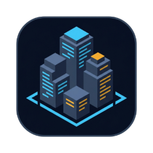
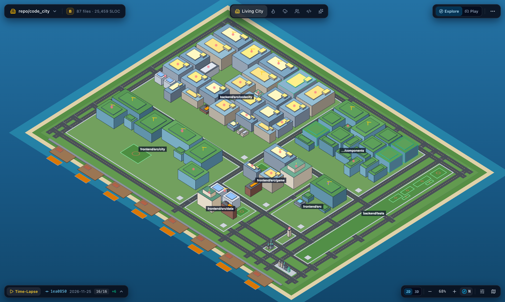
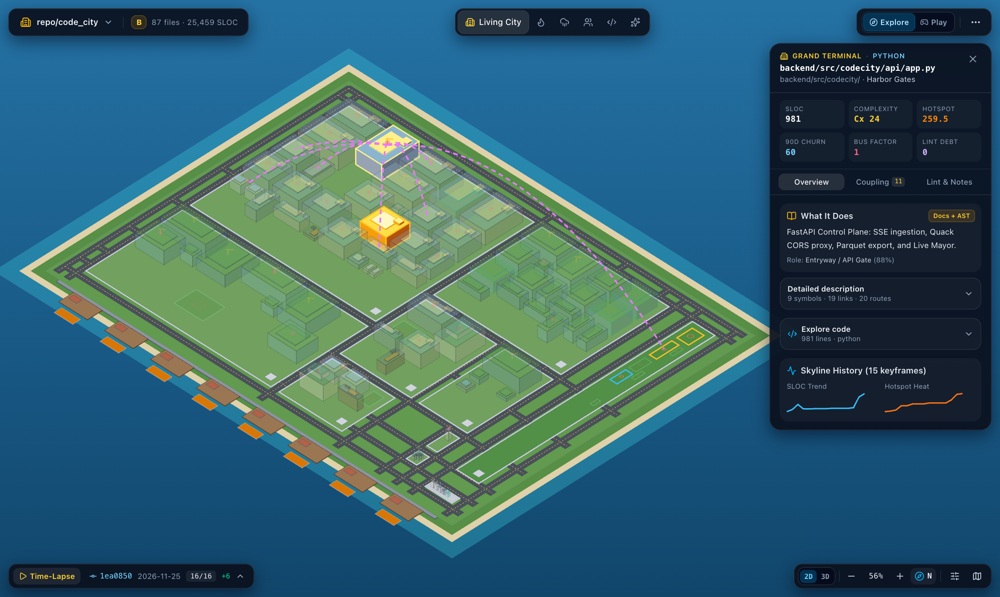
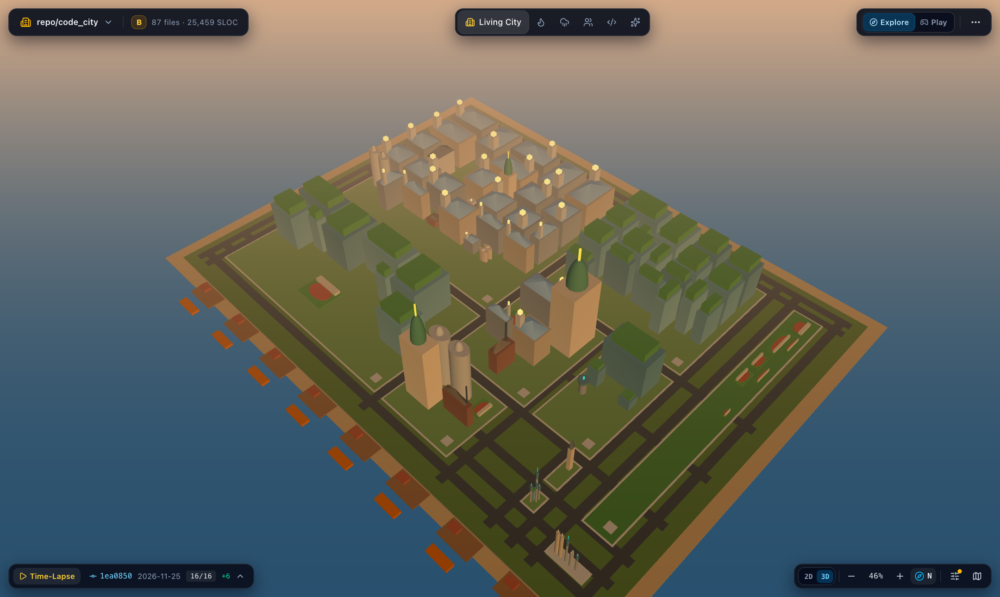

<div align="center">

  

  <h1>CodeCity</h1>

  <p><strong>Turn any Git repository into a living isometric &amp; 3D codebase city.</strong></p>

  <p>
    Explore architectural structure, commit history, blast radius, and code health across Python, TypeScript/JS, Rust, and Go — powered by Tree-sitter, DuckLake, and in-browser DuckDB-Wasm.
  </p>

  <p>
    <a href="#quickstart">Quickstart</a> &nbsp;&bull;&nbsp;
    <a href="#features">Features</a> &nbsp;&bull;&nbsp;
    <a href="#cli">CLI</a> &nbsp;&bull;&nbsp;
    <a href="#architecture">Architecture</a> &nbsp;&bull;&nbsp;
    <a href="#development">Development</a>
  </p>

  <p>
    
  </p>

</div>

---

> [!IMPORTANT]
> **Local Mode Only (For Now):** CodeCity is currently built for **local mode only**. The control plane (`codecity serve`) binds to `127.0.0.1` by default, restricts API/CORS/CSRF requests to `localhost` / `127.0.0.1` origins, persists data in a local `.codecity/` DuckLake catalog, and runs repository analysis and Live Mayor Git operations directly on your machine with no user authentication or hosted/multi-tenant backend. Do not expose `codecity serve` to public networks.

## Quickstart

Requires [`uv`](https://docs.astral.sh/uv/) (`>= 0.5`, Python `3.12+`) and [`bun`](https://bun.sh/) (`>= 1.4.6` / native `bun lint` + `bun fmt`).

```bash
# 1. Install backend dependencies & build the studio UI
uv sync --extra dev
(cd frontend && bun install && bun run build)

# 2. Analyze a local repository or public Git URL
uv run codecity analyze . --max-keyframes 16 --workers 4

# 3. Launch the Studio UI locally (starts backend + HMR frontend, opens browser, auto-exits when tabs close)
bun dev
# Or serve the built UI directly on http://127.0.0.1:8787 (single process, no Vite):
# uv run codecity serve
```

### Previewing on Localhost

- **Single-Command Dev Mode (`http://127.0.0.1:5173`)**: Run `bun dev` (or `uv run codecity dev`) from the repo root. It automatically stops any older local CodeCity instance (`--no-replace` to keep running instances), starts both FastAPI (`:8787`) and Vite HMR (`:5173`), opens the Studio UI in your browser (`--no-open` to skip), and **auto-exits both servers** 15 seconds after you close the last browser tab (`--no-auto-exit` to keep running). Press `Ctrl+C`, click **Utilities → Stop Local Server**, or run `bun run stop` (`uv run codecity stop`) from any terminal to stop immediately.
- **Built Local App (`http://127.0.0.1:8787`)**: Run `uv run codecity serve` (or `bun run serve`) after building `frontend/dist` and open `http://127.0.0.1:8787`. Once dependencies are installed and a repository has been analyzed into `.codecity/`, you only need `uv run codecity serve` when you aren't editing frontend code (pass `--open` / `--auto-exit` if desired).
- **Read-Only Static Export Preview**: Export a static bundle and serve it over local HTTP (required for DuckDB-Wasm workers and Parquet fetches; `file://` will not work):

```bash
uv run codecity list
uv run codecity export <owner>/<repo> --out ./export-dist --postcard
python3 -m http.server 8080 --bind 127.0.0.1 --directory ./export-dist
# Open http://127.0.0.1:8080 (read-only snapshot; live analysis, fix diffs, Live Mayor Mode, and Quack require `codecity serve`)
```

---

## Features

- **Polyglot AST & Toolchain Analysis** — Parses Python (`Tree-sitter` + `ruff`), TypeScript/JS (`Tree-sitter` + `bun lint` / `bun fmt`), Go (`go.mod`), and Rust (`Cargo.toml` / `Cargo.lock`) across parallel `git worktree` historical keyframes.
- **2D Isometric Canvas & Lazy 3D City** — Toggle smoothly between a crisp SimCity-style 2D isometric view and a hardware-accelerated Three.js 3D skyline with zoned districts, Waterfront Supply Docks for external packages, building archetypes, and live traffic pulses.
- **Six Live Data Maps** — Switch perspectives between `Living City`, `Construction`, `Smog & Lint`, `Bus Factor`, `Languages`, and `Format Drift`.
- **Time Travel & Blast Radius** — Scrub historical keyframes, inspect transitive import cascades directly in-browser via recursive SQL, preview `--fix` diffs, and run chaos disaster simulations (Cascading Power Outage, Bus Factor Vacation, Release Crunch Storm, Supply Dock Storm).
- **Safe Mayor Mode & Co-Op Notes** — Test architectural refactors in sandbox mode, collaborate via persistent Mayor Notes, or apply real automated changes on an isolated `codecity/mayor-session` branch.
- **Zero-Backend Static Reports** — Share an entire navigable city backed solely by static Parquet files, `DuckDB-Wasm`, an SVG health badge, and a City Postcard PNG.

<table>
  <tr>
    <td align="center" width="50%">
      <br />
      <sub><strong>Building Inspector &amp; Coupling Arcs</strong> — Inspect AST metrics, summaries, source code, and Skyline History.</sub>
    </td>
    <td align="center" width="50%">
      <br />
      <sub><strong>3D City View</strong> — Hardware-accelerated Three.js skyline with Day, Golden Hour, and Night lighting.</sub>
    </td>
  </tr>
</table>

---

## CLI

Catalog data defaults to `.codecity/` (override with `codecity --data-dir <path> ...`).

| Command | Purpose |
| :--- | :--- |
| `codecity analyze <source>` | Analyze a local repo or Git URL (`--max-keyframes`, `--workers`, `--semantic`, `--owner`, `--repo`) |
| `codecity list` | List analyzed repositories, snapshot counts, file counts, and health grades |
| `codecity serve` | Start the FastAPI control plane, Quack CORS proxy, and built Studio UI (`--host`, `--port`, `--open`, `--auto-exit`, `--no-replace`) |
| `codecity dev` | Start FastAPI + Vite HMR together (`bun dev` alias; auto-replaces older instances, opens browser, auto-exits on tab close) |
| `codecity stop` | Cleanly stop a running local `codecity dev` or `codecity serve` instance (`bun run stop` alias; `--force`) |
| `codecity export <owner/repo>` | Export a static DuckDB-Wasm bundle (`--out <dir>`, `--postcard`) |

---

## Architecture

| Layer | Stack | Role |
| :--- | :--- | :--- |
| **Analyzer** | `Tree-sitter`, `ruff`, `bun`, `git worktree` | Multi-worker keyframe AST, complexity, lint, churn, and dependency extraction with symlink/SSRF validation, sanitized `bun lint`/`bun fmt` config isolation, and hook/SSH-config-disabled Git execution |
| **Lakehouse** | `DuckDB 2.0`, `DuckLake 1.1`, `Quack` | Concurrent nested schemas (`repos.<owner>.<repo>`), `VARIANT` metrics, Parquet export, and audit feeds |
| **Control Plane** | `FastAPI`, `uvicorn`, stdlib HTTP, SSE | Thin local server with bounded per-repo jobs and Mayor locks, `Host` & CSRF origin checks, validated payloads, SSE progress, atomic exports, localhost Quack proxy, sandboxed SVG badges, and Mayor Git actions |
| **Studio UI** | `React`, `DuckDB-Wasm`, `Canvas 2D`, bare `Three.js` | Client-side Parquet SQL analytics (snapshots, blast radius, city tours, health reports), in-memory Refactor Sandbox overlays, and instanced 2D/3D rendering across Live and Static modes (Vite + React Fast Refresh) |

---

## Development

Run the full verification suite across backend and frontend:

```bash
# Backend formatting, lint, unit/API tests, and Playwright E2E
uv run ruff format --check backend/src backend/tests
uv run ruff check backend/src backend/tests
uv run --extra dev pytest -v

# Frontend formatting, typecheck, lint, unit tests, and production bundle
cd frontend && bun fmt --no-script --check && bun check && bun run lint && bun test && bun run build
```
